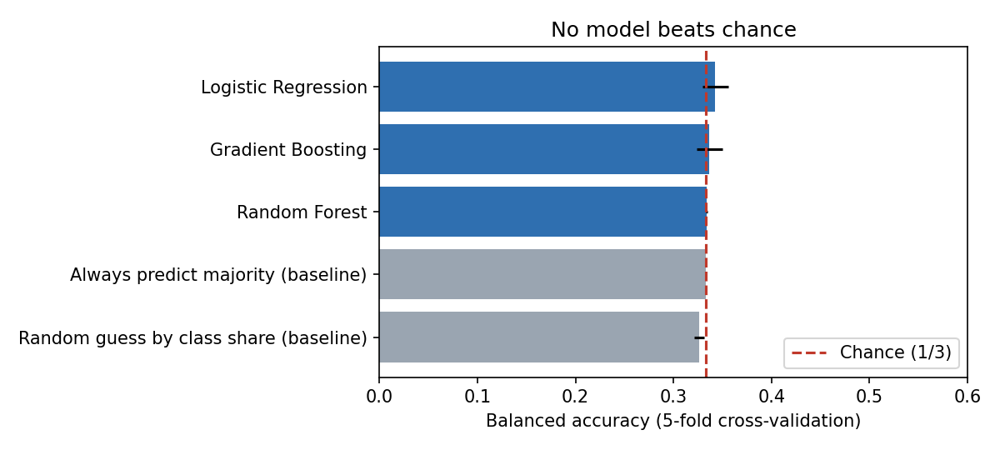
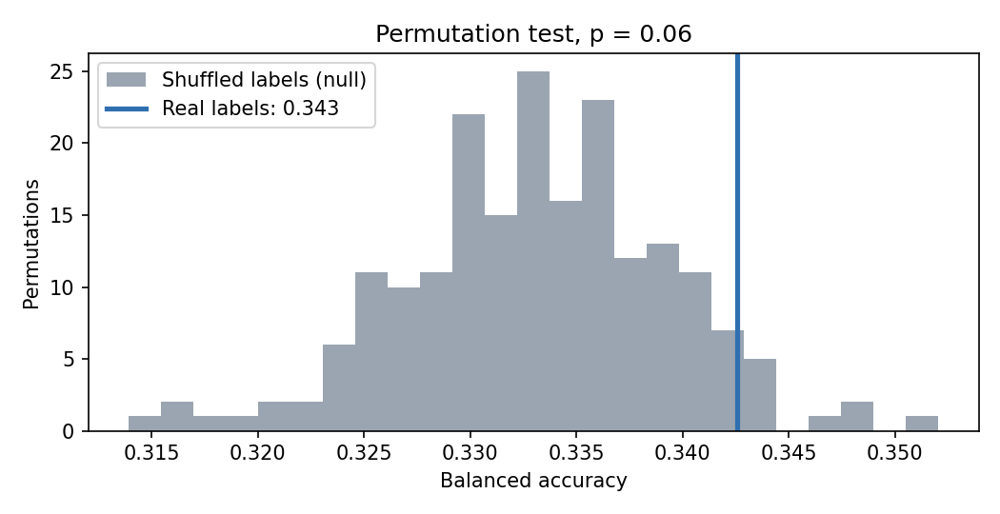
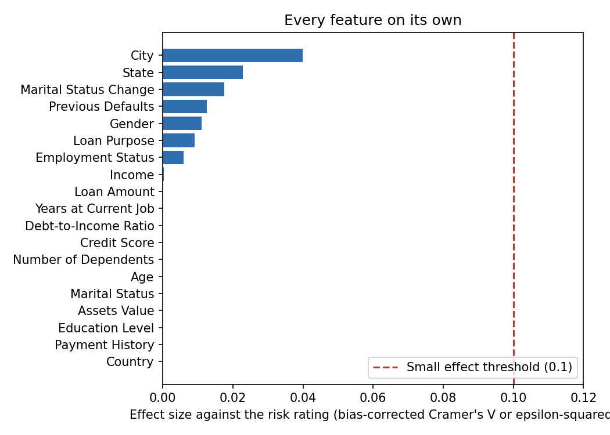

# Credit Risk Signal Audit

> Machine Learning coursework, The British University in Egypt, December 2025. Author: Ziad Ayman.

Can a person's income, credit score, loan amount and payment history predict their loan risk rating? On this dataset, **no**. This project shows how to prove that rigorously instead of reporting a misleading accuracy number.

The original coursework trained Logistic Regression, SVM and Random Forest models and got up to **59.8% accuracy**, which looks reasonable until you notice that 60% of the rows are rated "Low": the Random Forest predicted "Low" for almost every applicant and never found a single "High" risk case. This version turns that observation into a full statistical audit.

## Results (15,000 applicants, 5-fold cross-validation)

| Model | Balanced accuracy | Macro F1 | Accuracy |
|---|---|---|---|
| Always predict "Low" (baseline) | 0.333 | 0.250 | **0.600** |
| Random guess by class share (baseline) | 0.326 | 0.326 | 0.457 |
| Logistic Regression (class-weighted) | **0.343** | 0.293 | 0.315 |
| Gradient Boosting (class-weighted) | 0.337 | 0.312 | 0.358 |
| Random Forest (class-weighted) | 0.334 | 0.274 | 0.586 |

Chance for three classes is a balanced accuracy of **0.333**. The best model is 0.01 above it, and the do-nothing baseline has the highest plain accuracy.



## The evidence

1. **Permutation test.** The best model was refitted 200 times on shuffled labels. Its real score (0.343) sits inside that null distribution (mean 0.333, 95th percentile 0.343), **p = 0.06**: not distinguishable from chance.

   

2. **Every feature on its own.** Chi-squared or Kruskal-Wallis tests for all 19 features, with **Holm-Bonferroni correction** for multiple testing. No feature is significant after correction. The smallest raw p-value (Marital Status Change, p = 0.010) is exactly what you expect by luck among 19 tests, and it becomes p = 0.19 after correction. Every effect size is below 0.04, where 0.1 is the usual threshold for even a *small* effect.

   

   Effect sizes use the **bias-corrected Cramer's V**: the plain version made City (about 10,000 distinct values) look like the strongest feature purely because of how many categories it has.

3. **Positive control.** To show that the pipeline *can* find signal when it exists, I added one synthetic feature weakly related to the label. The same Logistic Regression pipeline picked it up straight away:

   | Planted feature strength | 0 (real data) | 0.25 | 0.5 | 1.0 |
   |---|---|---|---|---|
   | Balanced accuracy | 0.343 | 0.393 | 0.455 | 0.580 |

   So the low scores come from the data, not from a broken pipeline.

## Conclusion
The risk ratings in this dataset are statistically independent of the applicant features, which is typical of randomly generated practice datasets. No model or tuning can fix that. In a real project the next step would be to question the labels and collect better data, not to search for a bigger model. The lesson: always compare against a majority-class baseline, use balanced metrics on imbalanced labels, and test against shuffled labels before trusting a score.

## Run it
```bash
pip install -r requirements.txt
# place financial_risk_assessment.csv (the Kaggle "Financial Risk Assessment" dataset, 15,000 rows) in data/
python -m riskaudit --permutations 200     # about 30 seconds; writes results/audit.json and the figures
python -m pytest -q                        # 9 tests
```

## Design
```
riskaudit/
├── data.py      # schema validation (required columns, allowed labels)
├── models.py    # baselines and class-weighted models in leakage-safe pipelines
│                #   (imputation, scaling and encoding are fitted inside each fold)
├── audit.py     # association tests, Holm correction, bias-corrected Cramer's V,
│                #   cross-validation, permutation test, positive control, verdict
└── __main__.py  # command line, figures and results/audit.json
```
The tests run the audit on synthetic data with the same schema: it must find **no signal** in pure noise and **must** detect a planted relationship. They also check the Holm correction against a hand calculation, the bias correction on a high-cardinality column, and the schema validation.

## Tech stack
Python · pandas · scikit-learn · SciPy · matplotlib · pytest
